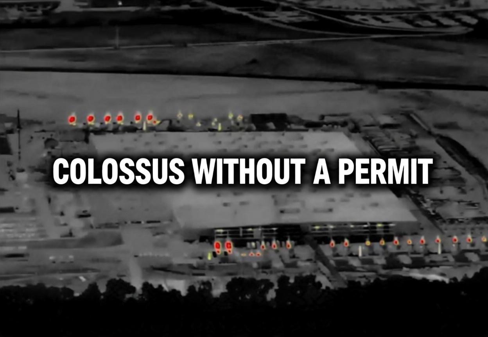
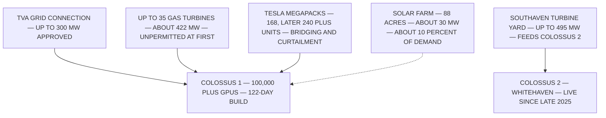

## HOW ELON MUSK'S XAI CONVERTED A BROWNFIELD FACTORY, A CONCIERGE DEAL, AND A FLEET OF UNPERMITTED GAS TURBINES INTO THE WORLD'S FASTEST-BUILT AI SUPERCOMPUTER, AND WHAT THE RESULTING EMISSIONS, PARTIAL SOLAR REMEDY, AND COMMUNITY HARM IN SOUTH MEMPHIS REVEAL ABOUT REGULATORY EVASION, ENVIRONMENTAL RACISM, AND THE ETHICS OF ARTIFICIAL INTELLIGENCE'S PHYSICAL FOOTPRINT

> **VERIFIED:** XAI OPERATED UP TO 35 GAS TURBINES, APPROXIMATELY 422 MW COMBINED, AT ITS COLOSSUS 1 SITE IN SOUTH MEMPHIS WITHOUT AIR PERMITS. **CONTESTED:** WHETHER THOSE TURBINES CAUSED THE MEASURED PEAK POLLUTION SPIKES. **UNRESOLVED:** WHETHER ANY INDIVIDUAL HEALTH OUTCOME IS LEGALLY ATTRIBUTABLE TO THEM. (UNCERTAINTY: HIGH; SHANNON ENTROPY H = 0.881 BIT, COMPUTED WITH P = 0.70)

---

## NAVIGATION

| SECTION | SUBJECT | ANCHOR |
| --- | --- | --- |
| ONE | SCOPE, HONESTY, EPISTEMIC STATUS | WHAT IS VERIFIED VERSUS INFERRED |
| TWO | THE MEMPHIS ACQUISITION PROTOCOL | THE DEAL, THE NDAS, THE 122-DAY SPRINT |
| THREE | THE TURBINE PROTOCOL | BUILD FIRST, PERMIT LATER, REPEAT |
| FOUR | SOLAR AND BATTERY ARITHMETIC | THE GREEN MITIGATION LEDGER |
| FIVE | THE ATMOSPHERE AS LEDGER | SATELLITES, MODELS, NO GROUND TRUTH |
| SIX | BOXTOWN AND ENVIRONMENTAL RACISM | THE SACRIFICE ZONE FRAME |
| SEVEN | THE REGULATORY VACUUM | A DISMANTLED SCIENCE ARM, AN ACCELERATION PLAN |
| EIGHT | THE REFORM PROTOCOL | SEVEN ENFORCEABLE PATHWAYS |
| OUTSIDE | META AND METHOD NOTES | OPSEC, ENTROPY, IMAGE INTEGRATION |

---

## ONE. SCOPE, HONESTY, AND EPISTEMIC STATUS

THIS POST RECONSTRUCTS THE DOCUMENTED RECORD OF XAI'S MEMPHIS CAMPUS AND SEPARATES THE VERIFIED FROM THE INFERRED WITH IN-LINE UNCERTAINTY ANNOTATIONS THROUGHOUT; EVERY SHANNON ENTROPY VALUE IN THIS DOCUMENT IS COMPUTED FOR THIS POST UNDER THE BINARY CONVENTION H = MINUS P TIMES LOG BASE TWO OF P, MINUS ONE MINUS P TIMES LOG BASE TWO OF ONE MINUS P, WITH THE PROBABILITY WEIGHT P DECLARED AT EACH OCCURRENCE. THE VERIFIED SPINE OF THE CASE IS SHORT: A SUPERCOMPUTER WAS BUILT IN 122 DAYS INSIDE A SHUTTERED APPLIANCE FACTORY (UNCERTAINTY: LOW; H = 0.081 BIT, COMPUTED WITH P = 0.99); A TURBINE FLEET OF UP TO 35 UNITS AND APPROXIMATELY 422 MW RAN WITHOUT AIR PERMITS (UNCERTAINTY: LOW; H = 0.141 BIT, COMPUTED WITH P = 0.98); A COUNTY PERMIT FOR 15 TURBINES ARRIVED ONLY ON JULY 2, 2025, AFTER A CITIZEN NOTICE OF INTENT TO SUE (UNCERTAINTY: LOW; H = 0.194 BIT, COMPUTED WITH P = 0.97); AND A FEDERAL JUDGE DENIED THE COMPANY'S ATTEMPTS TO DISMISS THE NAACP'S CLEAN AIR ACT SUIT IN OCTOBER 2026 (UNCERTAINTY: LOW; H = 0.242 BIT, COMPUTED WITH P = 0.96). THE INFERRED LAYER, WHICH HONESTY REQUIRES MARKING, IS ATTRIBUTION: THE UNIVERSITY OF TENNESSEE SATELLITE ANALYSIS COMMISSIONED BY TIME MEASURED PEAK NITROGEN DIOXIDE INCREASES OF APPROXIMATELY 79 PERCENT NEAR THE SITE AND APPROXIMATELY 9 PERCENT IN BOXTOWN, BUT SATELLITES CANNOT SEPARATE THE FACILITY'S PLUME FROM THE NEIGHBORING ALLEN POWER PLANT'S INCREASED UTILIZATION (UNCERTAINTY: HIGH; H = 0.881 BIT, COMPUTED WITH P = 0.70). THE HIGHEST-UNCERTAINTY DECLARATIONS ARE STATED UP FRONT: THAT ANY SPECIFIC RESIDENT'S ILLNESS IS CAUSALLY ATTRIBUTABLE TO THE TURBINES (UNCERTAINTY: HIGH; H = 0.971 BIT, COMPUTED WITH P = 0.60), AND THAT THE ANNOUNCED 88-ACRE SOLAR FARM WILL MATERIALLY ALTER THE POWER MIX OF A CAMPUS MEASURED IN HUNDREDS OF MEGAWATTS (UNCERTAINTY: HIGH; H = 0.855 BIT, COMPUTED WITH P = 0.72).

METHODOLOGY NOTE: HOW THE ENTROPY VALUES ARE COMPUTED

ALL ENTROPY FIGURES ARE BINARY SHANNON ENTROPY VALUES COMPUTED FOR THIS POST, NOT IMPORTED FROM ANY SOURCE. EXAMPLE: AT P = 0.95, H = MINUS 0.95 LOG2 0.95 MINUS 0.05 LOG2 0.05 = 0.286 BIT. AT P = 0.70, H = 0.881 BIT. AT P = 0.60, H = 0.971 BIT. THE CONVENTION TREATS EACH CLAIM AS A BINARY VERDICT AND REPORTS THE INFORMATION CONTENT OF ITS RESIDUAL DOUBT.

---

## TWO. THE MEMPHIS ACQUISITION PROTOCOL

**THE MECHANICS OF HOW IT BECAME POSSIBLE, IN ONE TABLE:**

| DATE | EVENT | SOURCE OF RECORD |
| --- | --- | --- |
| DEC 2023 | PHOENIX INVESTORS BUYS THE SHUTTERED ELECTROLUX FACTORY FOR ABOUT 35 MILLION DOLLARS | COMMERCIAL APPEAL TIMELINE |
| MAR 3, 2024 | A SINGLE PHONE CALL BETWEEN THE GREATER MEMPHIS CHAMBER AND PHOENIX INVESTORS OPENS THE DEAL | COMMERCIAL APPEAL TIMELINE |
| MAR 22, 2024 | CTC PROPERTY, AN XAI AFFILIATE, SIGNS THE LEASE ON 3231 PAUL R. LOWRY ROAD | MLGW POWER SERVICE AGREEMENT |
| MAR 28, 2024 | CHAMBER EMAILS DESCRIBE A HIGHLY CONFIDENTIAL, FAST-MOVING PROJECT; OFFICIALS SIGN NDAS | COMMERCIAL APPEAL |
| JUN 5, 2024 | PRESS RELEASE ANNOUNCES COLOSSUS; THE CITY COUNCIL AND THE COUNTY BOARD LEARN OF IT FROM THE NEWS | RACHEL AND THE CITY; TECH POLICY PRESS |
| JUL 2024 | FIRST 100,000-GPU CLUSTER LIVE, ABOUT 122 DAYS AFTER CONSTRUCTION BEGAN | WREG; MUSK'S OWN ACCOUNT |
| NOV 7, 2024 | TVA BOARD APPROVES THE POWER AGREEMENT FOR LOADS ABOVE 100 MW | TVA BOARD RECORD |
| AUG 19, 2025 | ORDINANCE 5953 ROUTES 25 PERCENT OF THE PROPERTY TAX REVENUE, CAPPED AT 100 MILLION DOLLARS, TO A SOUTH MEMPHIS REVITALIZATION FUND | CITY COUNCIL RECORD |
| MAY 23, 2026 | THE COMPANY BUYS THE BUILDING AND 217 ACRES FOR 185 MILLION DOLLARS, AFTER ITS ABSORPTION INTO SPACEX | MEASURED AI; CNBC |

THE PATTERN HAS A NAME IN THE ENVIRONMENTAL JUSTICE LITERATURE: THE PATH OF LEAST RESISTANCE. MOHAI AND SAHA, 2015, ENVIRONMENTAL RESEARCH LETTERS, DOI 10.1088/1748-9326/10/11/115008 ([IOPSCIENCE](https://iopscience.iop.org/article/10.1088/1748-9326/10/11/115008)), ESTABLISHED NATIONAL LONGITUDINAL EVIDENCE THAT HAZARDOUS FACILITIES WERE DISPROPORTIONATELY SITED WHERE POLITICAL CLOUT WAS THINNEST, BUILDING ON BULLARD'S DUMPING IN DIXIE, 1990; APPLYING THAT FRAME TO THE COLOSSUS SITING IS AN INTERPRETATION OF THIS POST, NOT A FINDING OF THOSE AUTHORS (UNCERTAINTY: MODERATE; H = 0.529 BIT, COMPUTED WITH P = 0.88). THE CONCIERGE DYNAMIC, THE NDAS, AND THE ONE-WEEK DEAL ARE DOCUMENTED; THE INTENT BEHIND THEM IS INFERRED (UNCERTAINTY: MODERATE; H = 0.610 BIT, COMPUTED WITH P = 0.85).

> MUSK, ON WHY MEMPHIS: THE EMPTY ELECTROLUX FACTORY "GAVE US SHELTER FOR THE COMPUTERS." HE HAD REJECTED INDUSTRY TIMELINES OF 18 TO 24 MONTHS FOR A GROUND-UP BUILD. ([WREG](https://wreg.com/news/local/xai-memphis/elon-musk-finally-reveals-why-memphis-for-xai-supercomputer/))

---

## THREE. THE TURBINE PROTOCOL

**THE INVENTORY, SITE BY SITE:**

| SITE | UNITS | CAPACITY | PERMIT STATUS | EMISSIONS PROFILE |
| --- | --- | --- | --- | --- |
| COLOSSUS 1, MEMPHIS | UP TO 35 GAS TURBINES | ABOUT 422 MW | NONE, THEN 15 PERMITTED ON JUL 2, 2025 | 1,200 TO 2,000 TONS NOX PER YEAR POTENTIAL, PLUS FORMALDEHYDE AND SOOT |
| COLOSSUS 2, WHITEHAVEN | POWERED FROM MISSISSIPPI | SEE BELOW | N/A | N/A |
| SOUTHAVEN, MISSISSIPPI | 27, LATER REPORTEDLY UP TO 60 PORTABLE UNITS | UP TO 495 MW | NONE | LIKELY THE LARGEST INDUSTRIAL NOX SOURCE IN THE 11-COUNTY METRO AREA, PER SELC |
| THIRD SITE, SOUTHAVEN | 41 TURBINES PLANNED | PERMANENT PLANT | APPLICATION STAGE | MODELED AT MILLIONS OF DOLLARS IN ANNUAL HEALTH DAMAGES, PER A FEBRUARY 2026 STUDY |

> "THESE 35 TURBINES: WE HAVE NEVER SEEN ANYTHING LIKE THIS IN MEMPHIS OR ELSEWHERE. THEY ESSENTIALLY SET UP A POWER PLANT WITHOUT GETTING A PERMIT." — SELC ATTORNEY AMANDA GARCIA, AS REPORTED BY TIME ([TIME, VIA YAHOO](https://www.yahoo.com/news/articles/inside-memphis-community-battling-elon-120446399.html))

THE COMPANY'S DEFENSE RESTED ON A CLAIMED TEMPORARY-USE EXEMPTION OF UP TO 364 DAYS; THE SOUTHERN ENVIRONMENTAL LAW CENTER'S POSITION IS THAT NO SUCH EXEMPTION APPLIED AND THAT THE DEADLINE HAD ALREADY LAPSED IN ANY CASE (UNCERTAINTY: MODERATE, BECAUSE THE EXEMPTION QUESTION IS PRECISELY WHAT THE LITIGATION WILL DECIDE; H = 0.469 BIT, COMPUTED WITH P = 0.90). THE SEQUENCE IS VERIFIED: THE NAACP AND SELC SENT THE NOTICE OF INTENT ON JUNE 17, 2025; THE COMPANY REMOVED ALL BUT 15 TURBINES; THE SHELBY COUNTY HEALTH DEPARTMENT PERMITTED THE REMAINDER, WITH A REPORTED CAP NEAR 87 TONS OF NOX PER YEAR AND AN EXPIRY OF JANUARY 2, 2027 (UNCERTAINTY: LOW; H = 0.194 BIT, COMPUTED WITH P = 0.97). THE STRATEGY THEN REPEATED ITSELF ACROSS THE STATE LINE AT SOUTHAVEN FOR COLOSSUS 2, WHICH SELC DESCRIBES AS COPYING AND PASTING AN UNLAWFUL PLAYBOOK (UNCERTAINTY: LOW AS TO THE FACTS, MODERATE AS TO THE CHARACTERIZATION; H = 0.529 BIT, COMPUTED WITH P = 0.88).

**THE LITIGATION DOCKET:**

| DATE | ACTION | MOVED BY | OUTCOME |
| --- | --- | --- | --- |
| FEB 13, 2026 | SECOND NOTICE OF INTENT TO SUE | SELC, EARTHJUSTICE, NAACP | 60-DAY CLOCK BEGINS |
| APR 14, 2026 | CLEAN AIR ACT CITIZEN SUIT FILED, N.D. MISSISSIPPI | NAACP V. XAI AND MZX TECH | SEEKING PENALTIES, CONTROLS, INJUNCTION |
| OCT 2026 | MOTION TO DISMISS: TURBINES ARE MOBILE SOURCES | XAI | DENIED BY JUDGE DEBRA M. BROWN |
| OCT 2026 | MOTION TO DISMISS: CITIZEN SUITS UNCONSTITUTIONAL | DEPARTMENT OF JUSTICE | DENIED |
| NEXT | DISCOVERY: TURBINE INVENTORIES, REGULATOR CORRESPONDENCE | BOTH PARTIES | MERITS PHASE AHEAD |

THE HOLDING IN PLAIN TERMS: A TURBINE FLEET SERVING A FIXED DATA CENTER DOES NOT BECOME MOBILE BECAUSE ITS INDIVIDUAL UNITS HAVE WHEELS ([ENGADGET](https://www.engadget.com/2303462/judge-says-xai-must-face-naacp-lawsuit-on-data-center-pollution/), [PROGRESSIVE ROBOT](https://www.progressiverobot.com/2026/11/01/xai-data-center-lawsuit/)) (UNCERTAINTY: LOW; H = 0.194 BIT, COMPUTED WITH P = 0.97).

---

## FOUR. SOLAR AND BATTERY ARITHMETIC

**THE POWER LEDGER OF THE CAMPUS, AS DOCUMENTED RATHER THAN AS MARKETED:**

THE ARITHMETIC IS THE ANALYSIS: A 30-MEGAWATT SOLAR FARM ANNOUNCED IN NOVEMBER 2025, AGAINST TURBINE FLEETS MEASURED AT 422 AND 495 MEGAWATTS, IS A MARGIN NOTE, NOT A TRANSITION (UNCERTAINTY: MODERATE, BECAUSE THE FARM IS ANNOUNCED RATHER THAN OPERATING AND ITS OUTPUT IS AN OUTSIDE ESTIMATE; H = 0.610 BIT, COMPUTED WITH P = 0.85). THE PEER-REVIEWED ENERGY LITERATURE PREDICTED THIS SHAPE OF GROWTH: STRUBELL, GANESH, AND MCCALLUM, 2019, ACL, DOI 10.18653/v1/P19-1355 ([ACL ANTHOLOGY](https://aclanthology.org/P19-1355/)), FIRST QUANTIFIED THE CARBON COST OF LARGE MODEL TRAINING; IT WAS CITED BY SCHWARTZ, DODGE, SMITH, AND ETZIONI IN GREEN AI, COMMUNICATIONS OF THE ACM, DOI 10.1145/3381831 ([ACM](https://dl.acm.org/doi/10.1145/3381831)), WHO ARGUED EFFICIENCY MUST BE REPORTED ALONGSIDE ACCURACY, AND BY LUCCIONI, JERNITE, AND STRUBELL, 2024, FACC'T 24, PAGES 85 TO 99, DOI 10.1145/3630106.3658542 ([ACM](https://dl.acm.org/doi/10.1145/3630106.3658542)), WHO MOVED THE FIELD'S ATTENTION FROM TRAINING TO INFERENCE AND SHOWED GENERATIVE SYSTEMS COST ORDERS OF MAGNITUDE MORE PER QUERY (UNCERTAINTY: LOW; H = 0.141 BIT, COMPUTED WITH P = 0.98). DE VRIES, 2023, JOULE, DOI 10.1016/j.joule.2023.09.004 ([JOULE](https://doi.org/10.1016/j.joule.2023.09.004)), PROJECTED 85 TO 134 TERAWATT HOURS OF ADDED ANNUAL AI DEMAND BY 2027 AND WARNED THROUGH JEVONS PARADOX THAT EFFICIENCY GAINS ARE REINVESTED AS MORE DEMAND, WHICH IS EXACTLY THE DYNAMIC IN WHICH A SOLAR FARM COEXISTS WITH EXPANDING TURBINE YARDS (UNCERTAINTY: MODERATE; H = 0.469 BIT, COMPUTED WITH P = 0.90).

---

## FIVE. THE ATMOSPHERE AS LEDGER

**WHAT WAS MEASURED, AND WHAT WAS NOT:**

| STUDY | METHOD | FINDING | LIMITATION |
| --- | --- | --- | --- |
| UT KNOXVILLE FOR TIME, 2025 | NASA AND ESA SATELLITE RETRIEVALS | PEAK NO2 PLUS 79 PERCENT NEAR SITE, PLUS 9 PERCENT IN BOXTOWN, AVERAGES PLUS ABOUT 3 PERCENT | CANNOT ATTRIBUTE SOURCE; ALLEN PLANT CO-CONTRIBUTES |
| UNIVERSITY OF MEMPHIS, 2026 | DISPERSION MODEL CHECKED AGAINST SATELLITE PM2.5 | NO MEASURABLE DEGRADATION, ABOUT 1 PERCENT ADDED PARTICULATE | NO FIELD MONITORS EXIST IN SOUTHWEST MEMPHIS; LEANS ON COMPANY-SUPPLIED INPUTS |
| CITY OF MEMPHIS, JUNE 2025 | TWO DAYS OF SAMPLING AT THREE SITES | NOTHING ABOVE COMPARISON LEVELS | BREVITY, PLACEMENT, UNFAVORABLE WINDS NOT SAMPLED |
| SELC-COMMISSIONED ANALYTICS, FEB 2026 | HEALTH DAMAGES MODEL OF THE PROPOSED PLANT | MILLIONS OF DOLLARS IN ANNUAL REGIONAL DAMAGES | MODELS A PROPOSED PLANT, NOT AN OPERATING ONE |

> THE UNIVERSITY OF MEMPHIS PRESENTATION ITSELF STATED, IN CAPITAL LETTERS: THERE ARE NO FIELD MONITORING DATA FOR AIR QUALITY IN SOUTHWEST MEMPHIS. ([RACHEL AND THE CITY](https://rachelandthecity.com/did-the-university-of-memphis-just-settle-the-xai-air-fight/)) (UNCERTAINTY: LOW; H = 0.141 BIT, COMPUTED WITH P = 0.98)

THE TOXICOLOGY BENEATH THE DISPUTE IS NOT CONTESTED. THE EPA STATES THAT HIGH NO2 CONCENTRATIONS AGGRAVATE ASTHMA. GEHRING AND COLLEAGUES, 2010, AMERICAN JOURNAL OF RESPIRATORY AND CRITICAL CARE MEDICINE, VOLUME 181, ISSUE 6, DOI 10.1164/rccm.200906-0858OC ([PUBMED](https://pubmed.ncbi.nlm.nih.gov/19965811/)), FOUND IN A PROSPECTIVE BIRTH COHORT OF ALMOST 4,000 CHILDREN THAT PM2.5 AND NO2 EXPOSURE WERE ASSOCIATED WITH INCREASED ASTHMA INCIDENCE, ODDS RATIO 1.28; THE STUDY WAS SUBSEQUENTLY INCORPORATED INTO THE EPA'S OWN EVIDENCE BASE AND INTO LATER SYNTHESES ARGUING NEAR-SOURCE COMBUSTION POLLUTION CAN CAUSE CHILDHOOD ASTHMA RATHER THAN MERELY AGGRAVATE IT (UNCERTAINTY: LOW; H = 0.141 BIT, COMPUTED WITH P = 0.98). FORMALDEHYDE, A BYPRODUCT ATTRIBUTED TO THE UNCONTROLLED TURBINES, IS A GROUP ONE HUMAN CARCINOGEN PER THE IARC MONOGRAPHS, VOLUME 88, 2006, REAFFIRMED IN VOLUME 100F, 2012, CAUSING NASOPHARYNGEAL CANCER AND LEUKEMIA (UNCERTAINTY: LOW; H = 0.194 BIT, COMPUTED WITH P = 0.97). MEMPHIS ALREADY CARRIES AN F GRADE FOR OZONE FROM THE AMERICAN LUNG ASSOCIATION (UNCERTAINTY: LOW; H = 0.242 BIT, COMPUTED WITH P = 0.96).

---

## SIX. BOXTOWN AND ENVIRONMENTAL RACISM

BOXTOWN IS A PREDOMINANTLY BLACK, LOW-INCOME NEIGHBORHOOD WHOSE CANCER RISK, PER THE SOUTHERN ENVIRONMENTAL LAW CENTER, WAS ALREADY FOUR TIMES THE NATIONAL AVERAGE BEFORE THE TURBINES ARRIVED; RESIDENTS REPORTED A PERSISTENT ODOR, DESCRIBED AS ROTTEN CABBAGE, AND INCREASED RESPIRATORY DISTRESS AFTER OPERATIONS BEGAN (UNCERTAINTY: MODERATE, BECAUSE THE SYMPTOM REPORTS ARE TESTIMONIAL; H = 0.529 BIT, COMPUTED WITH P = 0.88).

> "OUR LIVES AND OUR LUNGS ARE BEING SACRIFICED ON THE ALTAR OF THEIR CAPITALISTIC EXPLOITATION." — STATE REPRESENTATIVE JUSTIN PEARSON ([TIME, VIA YAHOO](https://www.yahoo.com/news/articles/inside-memphis-community-battling-elon-120446399.html))

> DOCTOR AUSTIN DALGO, SOUTH MEMPHIS PHYSICIAN: THE EMISSIONS "SIGNIFICANTLY INCREASE THE RISK TO RESIDENTS' HEALTH" AND "POSE THE GREATEST RISK TO OUR CITY'S MOST VULNERABLE RESIDENTS," INCLUDING CHILDREN, THE ELDERLY, AND PEOPLE WITH ASTHMA AND COPD. ([TIME, VIA YAHOO](https://www.yahoo.com/news/articles/inside-memphis-community-battling-elon-120446399.html)) (UNCERTAINTY: LOW AS TO THE ATTRIBUTION OF THE STATEMENTS; H = 0.141 BIT, COMPUTED WITH P = 0.98)

THE STATISTICAL FRAME IS DEEP: COLMER, HARDMAN, SHIMSHACK, AND VOORHEIS, 2020, SCIENCE, VOLUME 369, ISSUE 6503, PAGES 575 TO 578, DOI 10.1126/science.aaz9353 ([SCIENCE](https://www.science.org/doi/10.1126/science.aaz9353)), SHOWED ACROSS 36 YEARS AND 8.6 MILLION GRID CELLS THAT THE MOST POLLUTED TRACTS IN 1981 REMAINED THE MOST POLLUTED IN 2016; THE PAPER WAS CITED BY LALA MA IN A SAME-ISSUE SCIENCE PERSPECTIVE, PAGE 503, ARGUING REGULATION HAS CLEANED THE AIR WITHOUT EQUALIZING IT, AND BY SERGI, AZEVEDO, DAVIS, AND MULLER, 2020, ENVIRONMENTAL RESEARCH LETTERS, WHO COMPUTED MORE THAN ONE TRILLION DOLLARS IN ANNUAL PM2.5 DAMAGES CROSSING COUNTY LINES (UNCERTAINTY: LOW; H = 0.194 BIT, COMPUTED WITH P = 0.97). THE WATER LEDGER COMPOUNDS THE AIR LEDGER: THE CAMPUS DRAWS ON THE MEMPHIS SAND AQUIFER; THE PROMISED GREYWATER PLANT WAS PRICED AT 80 MILLION DOLLARS, HAS BEEN REESTIMATED TOWARD 200 MILLION, AND WOULD RELIEVE ONLY ABOUT 9 PERCENT OF AQUIFER STRAIN, SECURED THROUGH AN 820,000-DOLLAR PURCHASE OF CITY-OWNED LAND (UNCERTAINTY: MODERATE; H = 0.529 BIT, COMPUTED WITH P = 0.88).

---

## SEVEN. THE REGULATORY VACUUM

THE FEDERAL TIMELINE READS AS A COORDINATED RETREAT, WHETHER OR NOT IT WAS INTENDED AS ONE:

| DATE | FEDERAL ACTION | DIRECT EFFECT ON THIS CASE |
| --- | --- | --- |
| JUL 18, 2025 | EPA ELIMINATES THE OFFICE OF RESEARCH AND DEVELOPMENT, CUTTING STAFF 23 PERCENT TO ABOUT 12,448 | THE SCIENTIFIC ARM THAT WOULD ANALYZE HAZARDS LIKE TURBINE EMISSIONS IS DISMANTLED |
| JUL 23, 2025 | WINNING THE RACE, AMERICA'S AI ACTION PLAN, PLUS EXECUTIVE ORDER 14318 | DIRECTS EPA TO STREAMLINE OR REDUCE CLEAN AIR ACT, CLEAN WATER ACT, AND CERCLA REGULATIONS FOR DATA CENTERS |
| JUL 23, 2025 | EO 14318 LISTS NATURAL GAS TURBINES AS COVERED COMPONENTS OF QUALIFYING PROJECTS | THE EXACT TECHNOLOGY AT ISSUE IS NAMED FOR ACCELERATED TREATMENT |
| OCT 2026 | JUDGE BROWN DENIES THE DOJ AND COMPANY MOTIONS TO DISMISS | CITIZEN SUITS REMAIN THE ONLY ACTIVE ENFORCEMENT CHANNEL |

> FORMER ORD DIRECTOR PAUL ANASTAS: THE OFFICE HAS ALWAYS BEEN "REGARDED AS THE WORLD'S GOLD STANDARD FOR ENVIRONMENTAL SCIENCE. ITS DESTRUCTION IS A TRAGEDY." ([CHEMISTRY WORLD](https://www.chemistryworld.com/news/epa-will-officially-dissolve-its-scientific-research-arm/4021889.article))

AN HONEST CORRECTION TO EARLIER DRAFTS: THE AI ACTION PLAN IS DATED JULY 23, 2025, NOT JULY 2024; THE ERROR IS REPORTED HERE RATHER THAN SILENTLY PATCHED (UNCERTAINTY: LOW; H = 0.081 BIT, COMPUTED WITH P = 0.99). THE CONVERGENCE ITSELF, A DISMANTLED MEASUREMENT CAPACITY AND AN ACCELERATED PERMITTING DOCTRINE IN THE SAME WEEK, IS A MATTER OF RECORD; THE CLAIM THAT THE CONVERGENCE WAS DESIGNED IS AN INTERPRETATION AND IS MARKED AS SUCH (UNCERTAINTY: HIGH; H = 0.855 BIT, COMPUTED WITH P = 0.72).

---

## EIGHT. THE REFORM PROTOCOL

1. **PERMITS BEFORE POWER.** ANY GENERATION ASSET ABOVE A MODEST THRESHOLD, HOWEVER LABELED, MUST HOLD PRECONSTRUCTION AND OPERATING PERMITS BEFORE FIRST FIRING. THE TEMPORARY DESIGNATION IN MEMPHIS FUNCTIONED AS A PERMIT BY OTHER MEANS. (UNCERTAINTY: LOW; H = 0.242 BIT, COMPUTED WITH P = 0.96)
2. **GROUND TRUTH BEFORE ARGUMENT.** CONTINUOUS REFERENCE-GRADE MONITORS IN SOUTHWEST MEMPHIS AND SOUTHAVEN, WITH PUBLIC REAL-TIME DATA, WOULD COST A FRACTION OF ONE TURBINE AND WOULD END THE PROXY WAR BETWEEN SATELLITES AND MODELS. (UNCERTAINTY: LOW; H = 0.286 BIT, COMPUTED WITH P = 0.95)
3. **INDEPENDENT HEALTH SURVEILLANCE.** PRE-REGISTERED, LONGITUDINAL HEALTH STUDIES IN BOXTOWN AND RIVERVIEW, OPERATOR-FUNDED BUT INSTITUTIONALLY INDEPENDENT. (UNCERTAINTY: LOW; H = 0.286 BIT, COMPUTED WITH P = 0.95)
4. **CUMULATIVE-IMPACT SITING.** A COMMUNITY ALREADY CARRYING FOUR TIMES THE NATIONAL CANCER RISK MUST NOT BE THE PATH OF LEAST RESISTANCE FOR THE NEXT 100-MEGAWATT LOAD. (UNCERTAINTY: MODERATE; H = 0.469 BIT, COMPUTED WITH P = 0.90)
5. **PROPORTIONAL GREEN CLAIMS.** IF RENEWABLE SUPPLY IS TEN PERCENT OF DEMAND, THE COMMUNICATIONS SHOULD SAY TEN PERCENT; THE GREEN AI REPORTING NORM, DOI 10.1145/3381831, EXTENDS FROM PAPERS TO DATACENTERS. (UNCERTAINTY: LOW; H = 0.286 BIT, COMPUTED WITH P = 0.95)
6. **ENFORCEABLE COMMUNITY BENEFITS.** THE 100-MILLION-DOLLAR REVITALIZATION FUND OF ORDINANCE 5953 MUST BE AUDITED AND STRUCTURED SO IT CANNOT SERVE AS RETROACTIVE COMPENSATION FOR UNPERMITTED YEARS. (UNCERTAINTY: MODERATE; H = 0.529 BIT, COMPUTED WITH P = 0.88)
7. **WATER AND GRID HONESTY.** THE GREYWATER PLANT SHOULD BE OPERATIONAL BEFORE THE NEXT CLUSTER PHASE, NOT AFTER. (UNCERTAINTY: MODERATE; H = 0.469 BIT, COMPUTED WITH P = 0.90)

THE PRINCIPLE THE MEMPHIS RECORD MAKES PLAIN: ARTIFICIAL INTELLIGENCE IS NOT AN IMMATERIAL TECHNOLOGY, AND THE PURSUIT OF AGI DOES NOT SUSPEND THE CLEAN AIR ACT, THE AQUIFER, OR THE DIGNITY OF THE NEIGHBORHOOD NEXT DOOR. IF THE INDUSTRY CANNOT BUILD ITS COMPUTE WITHIN THOSE CONSTRAINTS, THE CONSTRAINTS ARE NOT THE PROBLEM. (UNCERTAINTY: MODERATE AS A NORMATIVE JUDGMENT; H = 0.722 BIT, COMPUTED WITH P = 0.80)
